```
 _____ ____      _    ___ _   _
|_   _|  _ \    / \  |_ _| \ | |
  | | | |_) |  / _ \  | ||  \| |
  | | |  _ <  / ___ \ | || |\  |
  |_| |_| \_\/_/   \_\___|_| \_|

Threat Response & Automated Intelligence Network
        Purple Team CLI  |  v1.0.0
```

# TRAIN Framework

**TRAIN** (Threat Response & Automated Intelligence Network) is a modular,
All-in-One **Purple Team** (Dual-Use: Red Team + Blue Team) cybersecurity
CLI tool combining Python, C++, and Go. It brings together network
recon, IDS/IPS, web auditing, CVE lookup, compliance checking, log
correlation, MITRE ATT&CK mapping, OSINT/geolocation, binary forensics, an
encrypted secrets vault, and phishing-awareness training — all inside a
single interactive terminal interface (TUI).

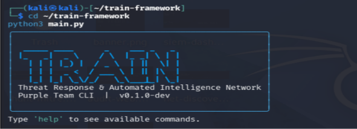

> ⚠️ **Ethical use only:** This tool is intended for use against your own
> systems, your own lab environment (VirtualBox/VMware lab), or systems
> you have explicit written authorization to test. Using it against
> systems without permission is illegal.

---

## 📋 Table of Contents

- [Features](#-features)
- [Architecture](#-architecture)
- [Installation](#-installation)
- [Command Reference](#-command-reference)
  - [Core commands](#core-commands)
  - [Network recon & IDS/IPS](#network-recon--idsips)
  - [Web auditing](#web-auditing)
  - [Vulnerability & compliance auditing](#vulnerability--compliance-auditing)
  - [Log analysis & threat hunting](#log-analysis--threat-hunting)
  - [OSINT & reputation](#osint--reputation)
  - [Binary forensics](#binary-forensics)
  - [Passwords & encryption](#passwords--encryption)
  - [Phishing awareness training](#phishing-awareness-training)
  - [Reporting](#reporting)
  - [Wireless & router auditing](#wireless--router-auditing)
  - [Secure networking](#secure-networking)
  - [Plugin system (TSE extensibility)](#plugin-system-tse-extensibility)
- [Screenshots](#-screenshots)
- [Project Structure](#-project-structure)
- [Contributing](#-contributing)

---

## ✨ Features

| Module | Language | What it does |
|---|---|---|
| `scanner.cpp` | C++ | Multi-threaded TCP port scanner + banner grabbing |
| `sniffer.go` | Go | libpcap-based, Snort-style IDS/IPS engine |
| `web_auditor.py` | Python | HTTP header/TLS/misconfig auditing + local forwarding proxy |
| `script_engine.py` | Python | TSE — FTP/SSH/HTTP/MySQL/PostgreSQL/MongoDB/Redis audit checks |
| `cve_lookup.py` | Python | NVD API CVE lookup + YAML template scanner |
| `compliance.py` | Python | CIS Benchmark-inspired local system compliance audit |
| `log_engine.py` | Python | SSH/nginx/PowerShell/LSASS log correlation |
| `threat_hunter.py` | Python | MITRE ATT&CK mapping + C2 beaconing detection |
| `osint_auditor.py` | Python | DNS enumeration, geolocation/ASN lookup, VirusTotal reputation |
| `api_tester.py` | Python | REST API testing and endpoint discovery |
| `binary_analyzer.py` | Python | Static PE/ELF forensics (headers, sections, entropy) |
| `pass_auditor.py` | Python | Password entropy + HaveIBeenPwned breach check |
| `vault_manager.py` | Python | AES-256 encrypted local secrets vault |
| `crypto_utils.py` | Python | Base64/Hex/URL encode-decode + hashing |
| `phish_awareness.py` | Python | Interactive phishing-recognition training with 44 examples across 4 difficulty levels |
| `dir_brute.py` | Python | Web directory/file discovery (gobuster/dirb-style) |
| `report_generator.py` | Python | Session findings as JSON, interactive HTML, and a styled PDF |
| `wifi_audit.py` | Python | Passive wireless network scan, router management-port audit, and LAN host discovery |
| `siem_dashboard.py` | Python | Live-updating SIEM-style dashboard over a log file |
| `secure_chat.py` | Python | End-to-end encrypted terminal-to-terminal chat over TCP |
| `plugin_engine.py` | Python | Loads user-written plugins from `plugins/` — TRAIN's Nmap-NSE-style extensibility system |

---

## 🏗 Architecture

```
                         ┌──────────────────────┐
                         │  main.py             │
                         │  TUI  or  -c command │
                         └──────────┬───────────┘
                                    │
                         ┌──────────▼───────────┐
                         │  core/tui_engine.py  │
                         │  menu, status, doctor│
                         └──────────┬───────────┘
                                    │
          ┌─────────────────────────┼──────────────────────────┐
          │                         │                          │
┌─────────▼────────┐    ┌───────────▼──────────┐    ┌──────────▼─────────┐
│ core/async_http  │    │ core/findings.py     │    │ core/bridge.py     │
│ timeouts, cap 8  │    │ one finding list     │    │ JSON contract      │
└─────────┬────────┘    └───────────┬──────────┘    └──────────┬─────────┘
          │                         │                          │
          │              ┌──────────▼──────────┐               │ subprocess
┌─────────▼────────┐     │ modules/*.py        │     ┌─────────▼──────────┐
│ templates/parser │     │ plugins/ + contract │     │ native_modules/    │
│ http-path/header │     │                     │     │ scanner.cpp        │
└──────────────────┘     └──────────┬──────────┘     │ sniffer.go         │
                                    │                └────────────────────┘
                         ┌──────────▼──────────┐
                         │ JSON + HTML + PDF   │
                         └─────────────────────┘
```

`main.py` registers every module and either opens the Rich / prompt_toolkit
TUI or runs a single command (`python main.py -c "doctor"`). Defensive HTTP
checks share `core/async_http.py` (asyncio + aiohttp) with a hard cap of 8
concurrent requests, bounded timeouts, and a response-size limit.
`templates/parser.py` accepts only `http-path` and `http-header` checks.
`core/plugin_contract.py` is the plugin interface: name, description, ports,
`run_check`, and a timeout the loader caps at 8 seconds. `core/bridge.py`
validates scanner JSON and refuses thread counts above 200. The C++ and Go
programs stay separate binaries; their stdout is still JSON.

---

## 🚀 Installation

### Requirements
- Python 3.10+ on Windows, Linux, or WSL2
- The Python TUI, reports, compliance checks, vault, and phishing quiz run
  without the native binaries
- `g++` (C++17), Go 1.20+, and `libpcap-dev` only if you build the Linux/WSL
  scanner and sniffer (`scanner.cpp` uses POSIX sockets)

### Steps

```bash
git clone https://github.com/umidguluzada/train-framework.git
cd train-framework
python -m pip install -r requirements.txt
python main.py
```

On Linux or WSL, the optional native binaries:

```bash
sudo apt update
sudo apt install -y build-essential golang-go libpcap-dev
cd native_modules
g++ -std=c++17 -O2 -pthread scanner.cpp -o train_scanner
go mod init train_sniffer
go get github.com/google/gopacket
go build -o train_sniffer sniffer.go
cd ..
python main.py -c "doctor"
```

> IDS/IPS (`sniff`/`ids-run`) requires root privileges to capture live
> packets: `sudo python3 main.py`.

> 💡 **Tip:** every command supports `<command> --help` (or `-h`) to show
> its own usage details, e.g. `scan --help`, `template-scan --help`,
> `vault-add -h`. `python main.py -c "doctor"` runs one command without
> staying in the prompt.

---

## 📖 Command Reference

### Core commands

From a shell, before entering the TUI:

```bash
python main.py --version
python main.py -c "doctor"
python main.py -c "help"
python main.py
```

| Command | Description |
|---|---|
| `menu` | Prints command groups and prompts for one command to run. |
| `set target <IP/URL>` | Sets the target for the current session. Most other commands fall back to this value if no target is given directly. |
| `status` | Shows target, command count, recorded findings, and whether the native binaries are built. |
| `doctor` | Checks Python 3.10+, third-party libraries, native binaries, and plugin load errors. |
| `help` | Lists all available commands. |
| `exit` / `quit` | Exits the program. |

**Examples:**
```
menu
set target 192.168.1.10
status
doctor
scan --help          # any command supports --help for its own usage
```

### Network recon & IDS/IPS

| Command | Description |
|---|---|
| `scan [start] [end]` | Multi-threaded C++ port scanner. Shows open ports, a service guess, and a banner. E.g. `scan 1 1024`. |
| `sniff <iface> [rules] [--ips]` | Starts the Go IDS/IPS engine. Matches live packets against Snort-style rules in `rules.conf`. With `--ips`, blocks the matching source IP via `iptables`. E.g. `sniff eth0 native_modules/rules.conf`. |
| `ids-run` | Alias for `sniff`. |

**Examples:**
```
set target 127.0.0.1
scan 1 1024
sniff lo native_modules/rules.conf
sniff eth0 native_modules/rules.conf --ips
```

### Web auditing

| Command | Description |
|---|---|
| `audit-web [url]` | Checks HTTP security headers (CSP, HSTS, X-Frame-Options, etc.), TLS certificate details, and well-known sensitive paths (`.git/config`, `.env`, `robots.txt`, etc.). |
| `web-proxy [port]` | Starts a lightweight local HTTP forwarding proxy (default port 8899). Logs every request/response passing through live. E.g. `curl -x http://127.0.0.1:8899 http://example.com`. |
| `api-test <url>` | Sends a GET+OPTIONS probe to a single API endpoint and shows status, allowed methods, and response structure. |
| `api-discover <base_url>` | Probes a set of common API path conventions (`/api`, `/health`, `/swagger.json`, etc.). |
| `dir-brute <url> [wordlist] [--threads N] [--ext ext1,ext2]` | Web directory/file discovery (gobuster/dirb-style). Sends plain GET requests to a wordlist of candidate paths and reports which respond with something other than 404. Uses a built-in wordlist if none is given. E.g. `dir-brute http://target.local --ext php,bak`. |

**Examples:**
```
audit-web http://127.0.0.1:8000
web-proxy 8899
api-test https://api.github.com
api-discover https://api.github.com
dir-brute http://127.0.0.1:8000 --ext php,bak,zip --threads 30
```

### Vulnerability & compliance auditing

| Command | Description |
|---|---|
| `run-tse [ports]` | TRAIN Scripting Engine — runs audit checks against the ports found by the last `scan` (or given manually): FTP anonymous login, SSH banner/algorithms, HTTP version disclosure, MySQL/PostgreSQL/MongoDB/Redis auth status. |
| `audit-cve <keywords>` | Searches the NVD (National Vulnerability Database) API for CVEs. `audit-cve --from-tse` auto-searches using banners from the last TSE run. |
| `template-scan <file.yaml>` | Runs simple HTTP-path checks defined in a local YAML template (a simplified, Nuclei-style scanner). |
| `audit-compliance` | Runs 7 CIS Benchmark-inspired checks on the local host: SSH root login, password policy, world-writable files, firewall status, audit daemon status. |

**Examples:**
```
set target 127.0.0.1
scan 1 100
run-tse
audit-cve OpenSSH 8.2
audit-cve --from-tse
template-scan templates/example-template.yaml
audit-compliance
```

### Log analysis & threat hunting

| Command | Description |
|---|---|
| `audit-logs <file> --format <type>` | Parses a log file into structured events. Supported formats: `auth` (SSH/sudo), `syslog`, `nginx` (HTTP access log), `json-alerts` (sniffer.go output), `powershell` (Windows Event ID 4104), `lsass` (Windows Event ID 4656/4663). Automatically flags brute-force sources. |
| `hunt-mitre` | Maps findings gathered this session (compliance, TSE, logs, IDS) to real MITRE ATT&CK technique IDs (T1110, T1548, T1078, etc.). |
| `hunt-beacon` | Statistically analyzes timestamps from the last `audit-logs --format nginx` run to detect C2 "beaconing" (regular, automated check-in) patterns. |

**Examples:**
```
audit-logs /var/log/auth.log --format auth
audit-logs /var/log/nginx/access.log --format nginx
hunt-mitre
hunt-beacon
```

### OSINT & reputation

| Command | Description |
|---|---|
| `audit-osint <domain>` | Passively enumerates a domain's DNS records (A, AAAA, MX, TXT, NS, CNAME, SOA). |
| `geo-track <ip/domain>` | Shows geolocation, ISP, and ASN for an IP/domain (via ip-api.com). |
| `check-vt <hash\|IP\|URL>` | Looks up a file hash, IP, or URL's full VirusTotal reputation (requires the `VT_API_KEY` environment variable): overall verdict, per-engine results from 90+ AV/security engines, categories, community votes, and first/last-seen dates. For a URL not yet known to VirusTotal, submits it for a fresh scan automatically. |

**Examples:**
```
audit-osint google.com
geo-track 8.8.8.8
check-vt 44d88612fea8a8f36de82e1278abb02f
check-vt http://example.com/suspicious-page
```

### Binary forensics

| Command | Description |
|---|---|
| `analyze-binary <file>` | Shows the headers, sections, entropy, and imported functions of a PE (Windows) or ELF (Linux) file — pure static analysis, no execution. |

**Examples:**
```
analyze-binary native_modules/train_scanner
analyze-binary ~/Downloads/suspicious.exe
```

### Passwords & encryption

| Command | Description |
|---|---|
| `audit-pass <password> [--offline]` | Calculates password entropy (bits) and checks it against HaveIBeenPwned's k-anonymity API for known breaches (`--offline` skips the network lookup). |
| `vault-init` | Creates a new AES-256 encrypted local secrets vault (prompts for a master password). |
| `vault-add <name>` | Adds a new value (password, API key, etc.) to the vault. |
| `vault-get <name>` | Decrypts and displays one value from the vault. |
| `vault-list` | Lists all entry names in the vault (without decrypting values). |
| `vault-remove <name>` | Removes an entry from the vault. |
| `encode <base64\|hex\|url> <text>` | Encodes text into the given format. |
| `decode <base64\|hex\|url> <text>` | Decodes encoded text. |
| `hash <md5\|sha1\|sha256\|sha512> <text>` | Computes the hash of a given text. |

**Examples:**
```
audit-pass MyP@ssw0rd123 --offline
vault-init
vault-add github-token
vault-get github-token
vault-list
encode base64 Hello World
decode base64 SGVsbG8gV29ybGQ=
hash sha256 test123
```

### Phishing awareness training

| Command | Description |
|---|---|
| `phish-awareness [level]` | Shows a random sample phishing/legitimate email and explains its red flags. Level: `easy`, `medium`, `hard`, `critical` (default: any). |
| `phish-quiz [count] [level]` | Interactive quiz — for each message, asks "phishing or legit?" and scores you at the end. E.g. `phish-quiz 10 hard`, `phish-quiz all critical`. |

**Examples:**
```
phish-awareness
phish-awareness critical
phish-quiz 5
phish-quiz 10 hard
phish-quiz all critical
```

### Reporting

| Command | Description |
|---|---|
| `generate-report [name.html]` | Writes three files from one finding list: `train_report.json`, an interactive `train_report.html` (severity buttons and a text filter), and a styled `train_report.pdf`. Passing `my-audit.html` uses that stem for all three. |
| `generate-pdf-report [output.pdf]` | Writes only the PDF summary (risk counts and the findings table). Default: `train_report.pdf`. |

**Examples:**
```
generate-report
generate-report my-audit.html
generate-pdf-report
```

### Wireless & router auditing

| Command | Description |
|---|---|
| `wifi-scan` | Lists nearby wireless networks (via `nmcli`) and flags weak/no encryption (Open, WEP, WPA1). Purely passive — reads what access points already broadcast, no handshake capture, no deauthentication, no cracking. |
| `router-audit <router_ip>` | Checks a router/access point's own management ports (Telnet, UPnP/SSDP, HTTP/HTTPS admin, TR-069) for risky exposure. Point it at your own router's LAN IP (e.g. `192.168.1.1`) — checks which ports respond only, never attempts login. |
| `net-discover <cidr>` | Finds live devices on a network range (e.g. `192.168.1.0/24`) via ICMP ping, showing each host's IP, reverse-DNS hostname, and MAC address (from the local ARP cache). No port scanning — use `scan <ip>` on a specific host for that. |

**Examples:**
```
wifi-scan
router-audit 192.168.1.1
net-discover 192.168.1.0/24
```

### Secure networking

| Command | Description |
|---|---|
| `siem-dashboard <file> --format <type> [--interval N]` | Live-updating SIEM-style dashboard over a log file — event counts by kind, top sources, active brute-force alerts, and recent activity, refreshing every few seconds. Built on the same parsers as `audit-logs`. Ctrl+C to stop. |
| `chat-listen <port> <passphrase>` | Waits for one incoming secure chat connection. Messages are encrypted with a key derived from the shared passphrase (PBKDF2 + Fernet/AES) before ever leaving the machine. |
| `chat-connect <host> <port> <passphrase>` | Connects to a peer running `chat-listen` with the same passphrase, for an end-to-end encrypted terminal chat session. Type `/quit` to leave. |

**Examples:**
```
siem-dashboard /var/log/auth.log --format auth --interval 3
# terminal A:
chat-listen 5566 my-shared-passphrase
# terminal B:
chat-connect 127.0.0.1 5566 my-shared-passphrase
```

### Plugin system (TSE extensibility)

TRAIN's equivalent of Nmap's NSE (Nmap Scripting Engine): drop a Python
file into `plugins/` following a small convention, and it becomes a new
port-triggered check that `run-tse` picks up automatically — no core
code changes needed. See `plugins/example_http_title.py` for the
template. Nine example plugins ship out of the box:

| Plugin | Ports | What it checks |
|---|---|---|
| `example_http_title.py` | all | Fetches the HTML `<title>` of whatever's on the port |
| `dns_banner.py` | 53 | DNS server version query |
| `rdp_exposure.py` | 3389 | Flags RDP exposure |
| `smtp_banner.py` | 25, 465, 587 | Mail server banner |
| `telnet_banner.py` | 23 | Flags Telnet exposure (unencrypted admin access) |
| `tls_cert_expiry.py` | 443, 8443 | Days remaining before the TLS cert expires |
| `vnc_banner.py` | 5900 | Flags VNC exposure |
| `ssh_banner_plugin.py` | 22, 2222 | Flags legacy SSH implementations in the banner |
| `security_headers_plugin.py` | 80, 443, 8080, 8443 | Flags dangerous CORS misconfigurations |

| Command | Description |
|---|---|
| `list-plugins` | Lists every plugin found in `plugins/`, and any load errors. |

**Examples:**
```
list-plugins
set target 127.0.0.1
scan 1 100
run-tse                 # built-in checks AND every matching plugin run together
```

**Write your own:** see `core/plugin_contract.py` and
`plugins/example_http_title.py`. Required: `PLUGIN_NAME` (str),
`PLUGIN_PORTS` (a list of ports, or `"all"`), and
`run_check(target, port)` returning `None` or a dict with
`result` / `severity` (`info`, `warning`, or `finding`) / `detail`.
Optional: `PLUGIN_DESCRIPTION` and `PLUGIN_TIMEOUT` (the loader caps
timeout at 8 seconds and runs plugins one at a time). Unknown severities
are stored as `info`. Plugins are arbitrary Python executed in-process —
only add plugins you wrote or have fully read.

---

## 🖼 Screenshots

### `scan` — multi-threaded port scan with banner grabbing
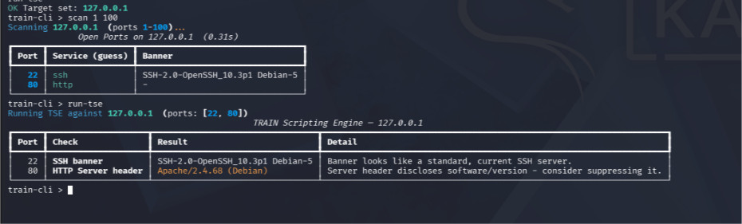

### `sniff` — live IDS alert on an incoming SSH connection
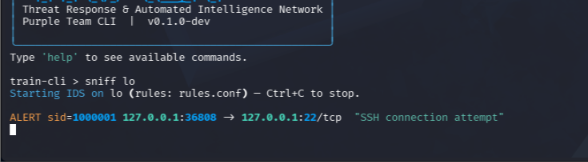

### `audit-web` — HTTP security header + sensitive path audit
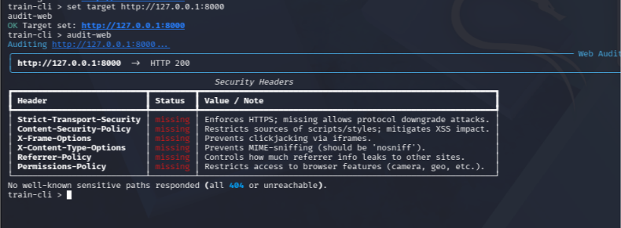

### `audit-compliance` — local CIS Benchmark-inspired checks
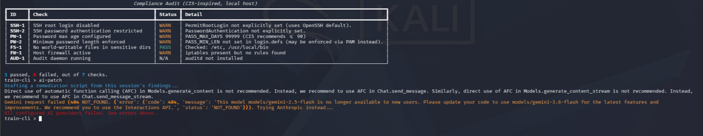

### `hunt-mitre` — findings mapped to MITRE ATT&CK techniques
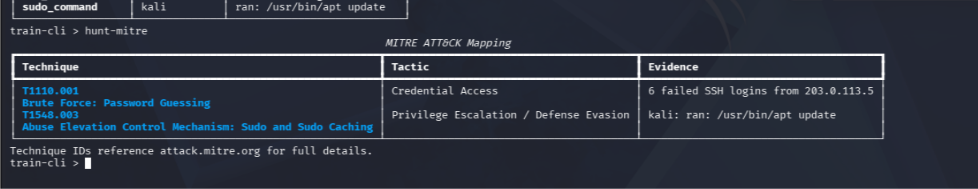

### `hunt-beacon` — statistical C2 beaconing detection
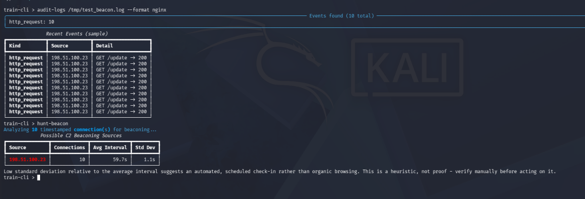

### `dir-brute` — web directory/file discovery
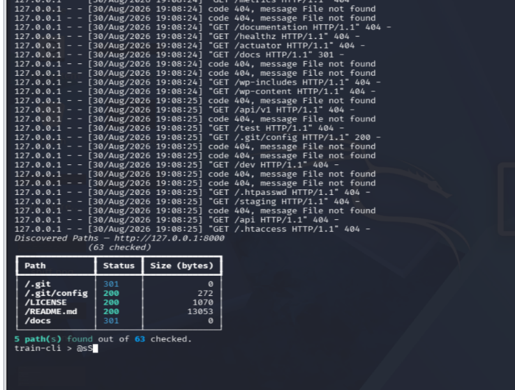

### `check-vt` — full VirusTotal reputation lookup (hash, IP, or URL)
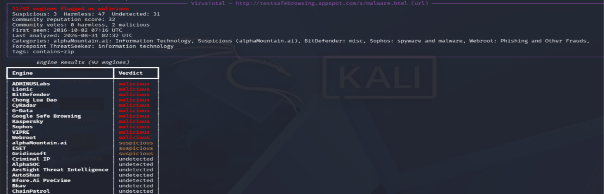

### `generate-report` — full session findings exported as HTML
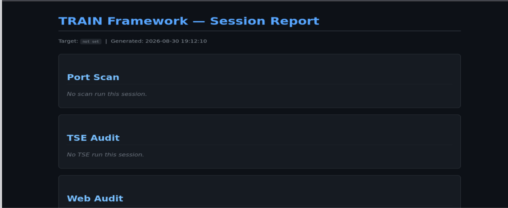

### `router-audit` — router/AP management-port exposure check
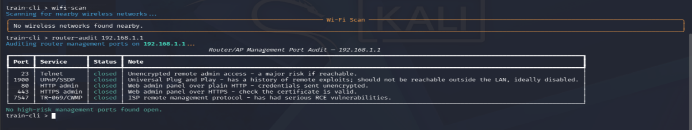

### `net-discover` — live LAN hosts, hostname, and MAC lookup
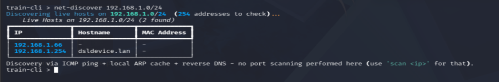

### `siem-dashboard` — live-updating SIEM-style event dashboard
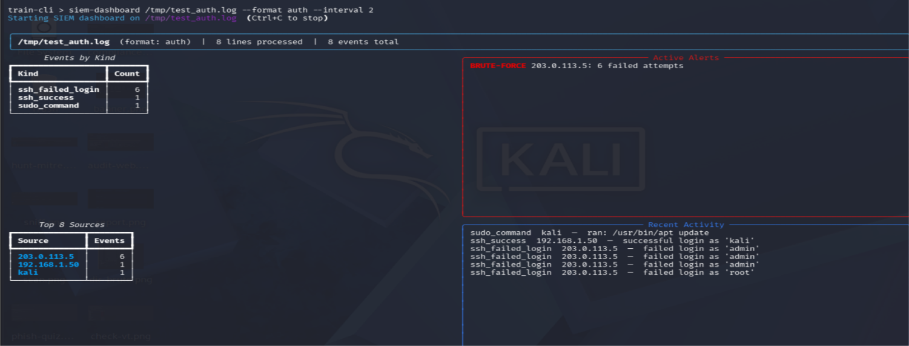

### `chat-listen` / `chat-connect` — end-to-end encrypted terminal chat
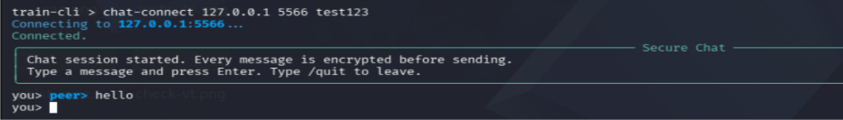

### `phish-quiz` — interactive phishing-awareness quiz
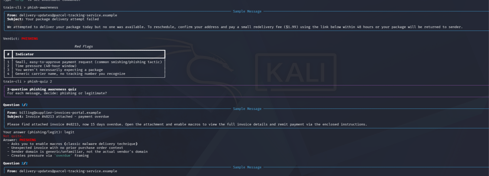

### `list-plugins` — loaded TSE plugins (Nmap-NSE-style extensibility)
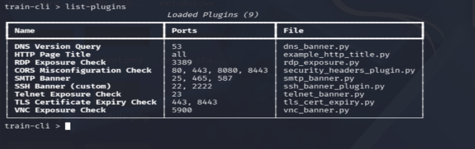

---

## 📁 Project Structure

```
train-framework/
├── main.py                      # Entry point (TUI or -c)
├── requirements.txt             # Exact Python dependency versions
├── README.md
├── tests/test_platform.py       # Offline tests for the platform layer
│
├── core/
│   ├── version.py               # Release version
│   ├── tui_engine.py            # TUI, menu, status, doctor
│   ├── async_http.py            # Capped asyncio/aiohttp client
│   ├── findings.py              # Shared finding list for reports
│   ├── plugin_contract.py       # Plugin interface
│   └── bridge.py                # Python ↔ C++/Go JSON bridge
│
├── native_modules/
│   ├── scanner.cpp              # C++ port scanner
│   ├── sniffer.go               # Go IDS/IPS engine
│   └── rules.conf               # Snort-style signature rules
│
├── templates/
│   ├── parser.py                # http-path and http-header templates
│   └── example-template.yaml
│
├── plugins/                      # User-extensible TSE checks
│   ├── example_http_title.py
│   ├── dns_banner.py
│   ├── rdp_exposure.py
│   ├── smtp_banner.py
│   ├── telnet_banner.py
│   ├── tls_cert_expiry.py
│   ├── vnc_banner.py
│   ├── ssh_banner_plugin.py
│   └── security_headers_plugin.py
│
├── docs/
│   └── screenshots/              # README screenshots
│
└── modules/
    ├── web_auditor.py
    ├── script_engine.py
    ├── cve_lookup.py
    ├── compliance.py
    ├── log_engine.py
    ├── threat_hunter.py
    ├── osint_auditor.py
    ├── report_generator.py
    ├── plugin_engine.py
    └── ...                  # vault, phishing quiz, wifi, SIEM, chat, and the rest
```

---

## 🤝 Contributing

This is a personal project built for learning and portfolio purposes.
Issues and pull requests with suggestions or fixes are welcome.

## 📜 License

This project is licensed under the [Apache License 2.0](LICENSE) — see the
`LICENSE` file for details.
